# Comandi di PokeGotchi

[](#tabella-di-equivalenza)
[](#tabella-di-equivalenza)
[](#tabella-di-equivalenza)
[](#tabella-di-equivalenza)
[](#console-seriale)
[](#installer-web)

Tutti i gesti, i pulsanti e i comandi di PokeGotchi, schermata per schermata. I numeri
(coordinate, tempi, soglie) vengono dai file `ui_*.cpp`; le stesse costanti sono raccolte in
[`tools/make_diagrams.py`](tools/make_diagrams.py), da cui si generano i diagrammi. Il
manuale di gioco (statistiche, uova, evoluzioni) è il [libretto del giocatore](https://francescomannarino.github.io/PokeGotchi/libretto-del-giocatore.pdf).

Coordinate in pixel dello schermo 466×466, origine in alto a sinistra, centro (233, 233).

## Indice

- [Tabella di equivalenza](#tabella-di-equivalenza)
- [Schermate](#schermate)
- [Gesti di base](#gesti-di-base)
- [Scelta dell'iniziale](#scelta-delliniziale)
- [Schermata principale](#schermata-principale)
- [Dialoghi e cerimonie](#dialoghi-e-cerimonie)
- [Scheda delle statistiche](#scheda-delle-statistiche)
  - [Collegamento](#collegamento) (con la [battaglia](#battaglia-in-collegamento) e lo
    [scambio](#scambio-in-collegamento))
- [Galleria / Pokédex](#galleria--pokédex)
  - [Collezione](#collezione)
- [Orologio e impostazioni](#orologio-e-impostazioni)
  - [Pannello Audio](#pannello-audio)
  - [Schermata dei salvataggi](#schermata-dei-salvataggi)
  - [Aggiornamento via WiFi](#aggiornamento-via-wifi)
- [Scelta dei giochi](#scelta-dei-giochi)
  - [Minigioco della pokéball](#minigioco-della-pokéball)
  - [Grotta Diglett](#grotta-diglett) e [Surf](#surf), a inclinazione
- [Scossone e colpetti](#scossone-e-colpetti)
- [Sacco da allenamento](#sacco-da-allenamento)
- [Battaglia](#battaglia)
- [Tastiera del nome](#tastiera-del-nome)
- [Pulsante PWR](#pulsante-pwr)
- [Console seriale](#console-seriale)
- [Salvataggi](#salvataggi)
  - [PWA (versione per browser e telefono)](#pwa-versione-per-browser-e-telefono), con i
    [limiti](#limiti)
- [Installer web](#installer-web)

## Tabella di equivalenza

Nella versione per browser e telefono (PWA, [più sotto](#pwa-versione-per-browser-e-telefono))
il mouse o il dito fanno da touch: un clic è un tocco, trascinare è uno scorrimento.

| Azione | ESP32 (touch) | Web desktop (mouse/tastiera) | iOS/Android (touch) |
|---|---|---|---|
| Coccolare | tocco sulla creatura | clic sulla creatura | come sulla scheda |
| Rilasciare | pressione lunga (3 s) sulla creatura | clic tenuto premuto 3 s sulla creatura | come sulla scheda |
| Nutrire | tocco su 🍎, poi sul cibo | clic su 🍎, poi sul cibo | come sulla scheda |
| Giocare | tocco su ⚽, poi su Palla, Grotta o Surf | clic su ⚽, poi sul gioco | come sulla scheda |
| Inclinare (Grotta, Surf) | inclinare la scheda | dito o mouse tenuto: joystick dal centro | inclinare il telefono (su iOS dopo il permesso, solo in `https`); senza permesso il joystick |
| Spaventare il pet | scossone | — (nell'emulatore Z) | scuotere il telefono |
| Chiamare il pet | doppio colpetto sulla scocca | — (nell'emulatore C) | — (il telefono non lo distingue da un tocco) |
| Luce (dormire / svegliare) | tocco su 🌙 | clic su 🌙 | come sulla scheda |
| Bagnetto | tocco su 🫧 | clic su 🫧 | come sulla scheda |
| Schiudere l'uovo | 3 tocchi ovunque | 3 clic ovunque | come sulla scheda |
| Evolvere / addio / fuga | tocco sul pulsante che compare | clic sul pulsante che compare | come sulla scheda |
| Aprire il Pokédex | scorrimento orizzontale | trascinare in orizzontale, o ← / → | come sulla scheda |
| Aprire la scheda | scorrimento verso l'alto | trascinare verso l'alto, o ↑ | come sulla scheda |
| Orologio, lingua, suono | scorrimento verso il basso | trascinare verso il basso, o ↓ | come sulla scheda |
| Salvataggi | orologio → «Salvataggi» | pulsante 💾 fuori dallo schermo (o, come sulla scheda, orologio → «Salvataggi») | come sul desktop |
| Rinominare | scheda → tocco sul nome | scheda → clic sul nome | come sulla scheda |
| Allenare la forza | scheda → pagina Lotta → «Allena forza» | stessi passi, con i clic | come sulla scheda |
| Lottare contro un selvatico | scheda → pagina Lotta → «Lotta» | stessi passi, con i clic | come sulla scheda |
| Collegarsi a un altro PokeGotchi | scheda → pagina Lotta → «Collega» | non c'è radio: «Radio non disponibile» | come sul desktop |
| Uscire da gioco / sacco / galleria | tocco sull'intestazione (in alto) | clic sull'intestazione | come sulla scheda |
| Schermo on/off | PWR breve (o un tocco per riaccendere) | pulsante ⏻ fuori dallo schermo, o P | pulsante ⏻ fuori dallo schermo |
| Spegnere | PWR lungo (4 s) | non serve: chiudi la scheda del browser | non serve: chiudi l'app |
| Foto dello schermo | — | S (scarica un PNG) | — |
| Installare | [installer web](#installer-web) (flash + sprite) | «Gioca nel browser», poi «Installa app» nella barra dell'indirizzo | Android: «Installa app»; iOS: Condividi → «Aggiungi alla schermata Home» |
| Suono | subito, dall'altoparlante | dal primo clic | dal primo tocco; su iPhone tace con l'interruttore del silenzioso |
| Giocare offline | sempre (sprite sulla microSD) | dopo «Scarica gli sprite per giocare offline» | come sul desktop, dall'app installata |
| Progressione da spento | RTC: il tempo da spenta si applica alla riaccensione | il tempo da chiusa si applica alla riapertura; niente notifiche | come sul desktop |
| Console seriale | USB, 115200 baud | `…/gioca/?debug`, o `pokegotchi.seriale('STATS')` nella console del browser | `…/gioca/?debug` |

Le differenze della PWA sono raccolte nei suoi [limiti](#limiti).

## Schermate

Foto dell'emulatore, che disegna con lo stesso codice della scheda (rigenerate da
`python3 tools/foto_doc.py`, che lancia `make smoke` di `tools/emu`). I diagrammi delle zone
di tocco sono nelle sezioni di ogni schermata, più sotto.

| | | | |
|:-:|:-:|:-:|:-:|
| 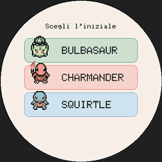 | 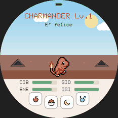 | 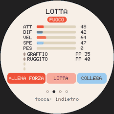 | 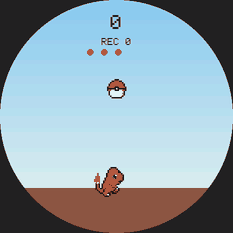 |
| [Scelta dell'iniziale](#scelta-delliniziale) | [Principale](#schermata-principale) | [Scheda, pagina Lotta](#scheda-delle-statistiche) | [Minigioco](#minigioco-della-pokéball) |
| 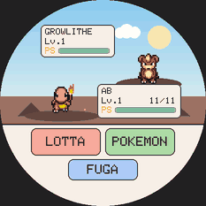 | 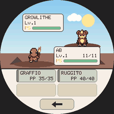 | 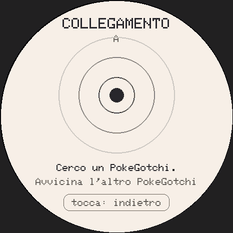 | 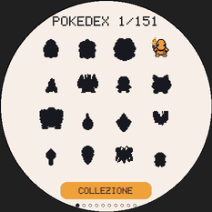 |
| [Battaglia](#battaglia) | [Mosse](#battaglia) | [Collegamento](#collegamento) | [Pokédex](#galleria--pokédex) |
| 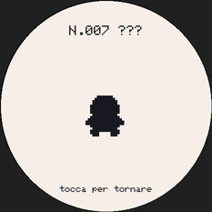 | 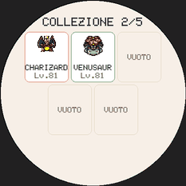 | 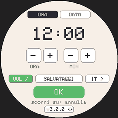 | 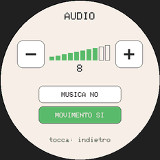 |
| [Dettaglio](#galleria--pokédex) | [Collezione](#collezione) | [Impostazioni](#orologio-e-impostazioni) | [Pannello Audio](#pannello-audio) |
| 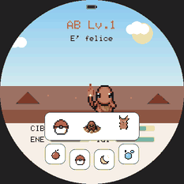 | 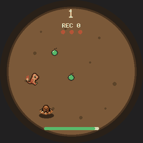 | 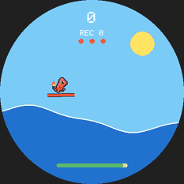 | 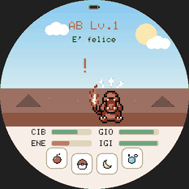 |
| [Scelta dei giochi](#scelta-dei-giochi) | [Grotta Diglett](#grotta-diglett) | [Surf](#surf) | [Scossone](#scossone-e-colpetti) |

## Gesti di base

Il gesto si riconosce quando il dito **si solleva** (`handleTouch()`, lettura a 50 Hz).

| Gesto | Condizione nel codice |
|---|---|
| Tocco | meno di 1,5 s, spostamento < 40 px su entrambi gli assi; conta il punto d'inizio |
| Scorrimento orizzontale | spostamento orizzontale > 80 px, verticale < 70 px, meno di 0,8 s |
| Scorrimento verticale | spostamento verticale > 80 px, orizzontale < 70 px, meno di 0,8 s |
| Pressione lunga | dito fermo (< 30 px) per oltre 3 s; scatta senza sollevare il dito |

- **Schermo attenuato o spento**: il primo gesto si limita a riaccendere lo schermo e non
  fa altro. Lo schermo si attenua dopo 90 s senza tocchi, di più dopo 5 minuti.
- Eccezione: nel **sacco da allenamento** ogni tocco conta appena il dito si appoggia.

## Scelta dell'iniziale

<picture>
  <source media="(prefers-color-scheme: dark)" srcset="docs/img/comandi/iniziale-scuro.svg">
  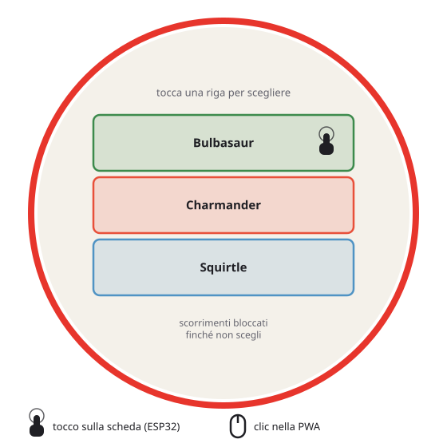
</picture>

Solo alla prima partita (o dopo `WIPE YES`). Tre righe una sotto l'altra, x 70–396,
alte 70 px a partire da y 110, con 8 px tra l'una e l'altra.

| Zona | Azione |
|---|---|
| Riga 1 (y 110–180) | Bulbasaur |
| Riga 2 (y 188–258) | Charmander |
| Riga 3 (y 266–336) | Squirtle |

Gli scorrimenti sono bloccati finché non scegli.

## Schermata principale

<picture>
  <source media="(prefers-color-scheme: dark)" srcset="docs/img/comandi/principale-scuro.svg">
  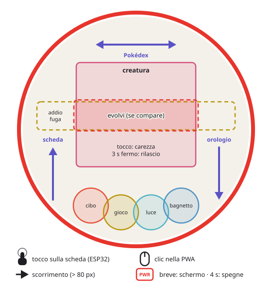
</picture>

| Zona | Gesto | Azione |
|---|---|---|
| Creatura (x 111–355, y 96–309) | tocco | carezza: +felicità, legame |
| Creatura | pressione lunga 3 s | dialogo «rilasciare?» |
| 🍎 cerchio r 36 in (140, 390) | tocco | menu del cibo (non mentre dorme) |
| ⚽ cerchio r 36 in (202, 404) | tocco | [scelta dei giochi](#scelta-dei-giochi) (non con l'uovo, mentre dorme, in una cerimonia) |
| 🌙 cerchio r 36 in (264, 404) | tocco | luce: dormire / svegliarsi |
| 🫧 cerchio r 36 in (326, 390) | tocco | bagnetto (3 s; non mentre dorme) |
| Pulsante rosso «evolvi» (105, 172, 256×64) | tocco | dialogo evolvere / mantenere |
| Pulsante dorato dell'addio (29, 176, 408×58) | tocco | dialogo addio / restare insieme |
| Pulsante scuro della fuga (stesso riquadro) | tocco | dialogo lasciarlo scappare / prendersene cura |
| Ovunque | scorrimento orizzontale | galleria / Pokédex |
| Ovunque | scorrimento verso l'alto | scheda delle statistiche |
| Ovunque | scorrimento verso il basso | orologio e impostazioni |

- **Uovo**: qualunque tocco conta come tocco sull'uovo; al terzo si schiude. La scheda e
  la pressione lunga non sono disponibili.
- I pulsanti di evoluzione, addio e fuga stanno sopra la creatura e hanno la precedenza
  sulla carezza. Pulsano, quindi il disegno si allarga di qualche pixel, ma la zona di
  tocco resta quella della tabella.
- La zona di tocco dei pulsanti icona è un cerchio di raggio 36 px, più grande dell'icona
  da 52×52.
- Sulla scheda uno **scossone** spaventa il pet e un **doppio colpetto** sulla scocca lo
  chiama: vedi [Scossone e colpetti](#scossone-e-colpetti).

### Menu del cibo

<picture>
  <source media="(prefers-color-scheme: dark)" srcset="docs/img/comandi/cibo-scuro.svg">
  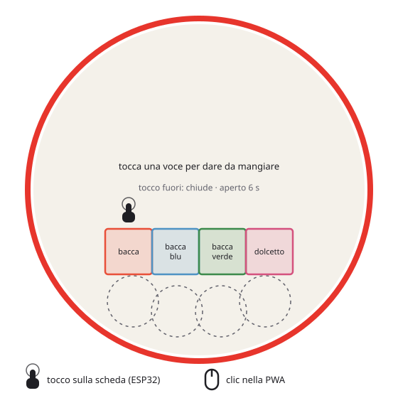
</picture>

Si apre con 🍎 e resta aperto 6 s. Riquadro x 101–365, y 288–352, quattro voci da 66 px.

| Voce (x) | Cibo |
|---|---|
| 101–166 | bacca |
| 167–232 | bacca blu |
| 233–298 | bacca verde |
| 299–364 | dolcetto (+felicità, ma fa ingrassare) |

Un tocco fuori dal riquadro chiude il menu senza dare niente.

## Dialoghi e cerimonie

<picture>
  <source media="(prefers-color-scheme: dark)" srcset="docs/img/comandi/dialoghi-scuro.svg">
  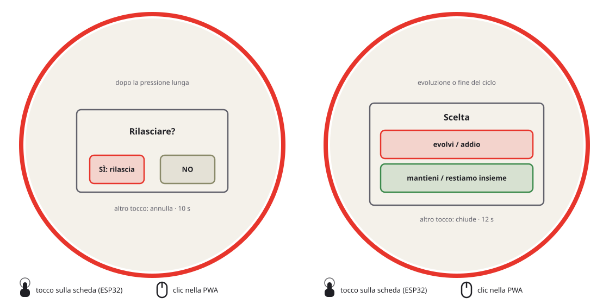
</picture>

Un dialogo aperto riceve tutti i tocchi: un tocco fuori dai pulsanti lo chiude senza
scegliere.

| Dialogo | Pulsanti | Durata |
|---|---|---|
| «Rilasciare?» (pressione lunga) | **SÌ** (118–218, 252–304) rilascia · **NO** e qualunque altro tocco annullano | 10 s |
| Evoluzione | **Evolvi** (93–373, 206–258) · **Mantieni forma** (93–373, 268–320) | 12 s |
| Addio | **Addio** (93–373, 206–258) · **Restare insieme** (93–373, 268–320) | 12 s |
| Fuga | **Lascialo andare** (93–373, 206–258) · **Me ne prendo cura** (93–373, 268–320), che chiude senza fare nulla: poi bisogna curarlo | 12 s |

- Con il dialogo «rilasciare?» o il menu del cibo aperti, gli scorrimenti verticali sono
  ignorati; con «rilasciare?» anche quello orizzontale.
- **Cerimonie** (addio, fuga, rilascio): durano 10 s e non accettano input. Tocchi,
  scorrimenti e pressione lunga sono ignorati finché non finiscono.
- **Domanda della collezione**: dopo un addio, o il rilascio di una forma finale, la
  cerimonia resta ferma sull'ultimo fotogramma con «Conservare <nome>?». Non scade, e
  dopo un riavvio si ripropone. **SÌ** (93–227, 268–320) lo mette nella collezione, **NO**
  (239–373, 268–320) rinuncia; gli altri tocchi sono ignorati. In entrambi i casi nasce
  l'uovo nuovo. Con la collezione piena compare l'elenco dei 5 posti (righe da 34 px da
  y 152, x 93–373): il tocco su una riga chiede «Liberare <nome>?» (SÌ libera quel posto e
  conserva il pet, ogni altro tocco torna all'elenco), **RINUNCIA** (y 322–362) non lo
  conserva.

## Scheda delle statistiche

<picture>
  <source media="(prefers-color-scheme: dark)" srcset="docs/img/comandi/scheda-scuro.svg">
  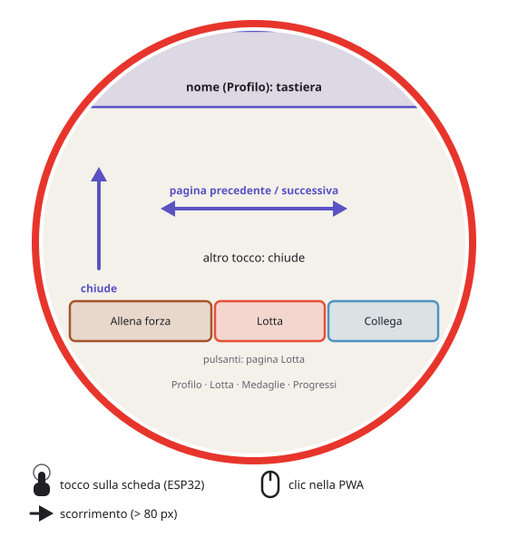
</picture>

Si apre scorrendo verso l'alto (non con l'uovo). Quattro pagine: Profilo, Lotta,
Medaglie, Progressi. La pagina Lotta mostra i tipi, ATK/DEF/VEL/SPC e il peso, le 4
mosse che userebbe in battaglia (le ultime imparate) con i loro PP, e i pulsanti «Allena
forza», «Lotta» e «Collega». Nel Profilo, un Pokémon ricevuto con uno
[scambio](#scambio-in-collegamento) mostra «AO: <nome>», il suo allenatore originale; i
Progressi contano gli scambi effettuati.

| Zona / gesto | Azione |
|---|---|
| Scorrimento a sinistra / a destra | pagina successiva / precedente (si ferma alla prima e all'ultima) |
| Scorrimento verso l'alto | chiude la scheda |
| Profilo: tocco in alto (y < 84) | tastiera del nome |
| Pagina Lotta: «Allena forza» (30–186, 298–342) | chiude la scheda e apre il sacco |
| Pagina Lotta: «Lotta» (190–311, 298–342) | battaglia contro un selvatico ([Battaglia](#battaglia)); grigio, se ora non può lottare: un suono di rifiuto e la scheda resta aperta |
| Pagina Lotta: «Collega» (315–436, 298–342) | [collegamento](#collegamento) con un altro PokeGotchi; la prima volta prima la tastiera del nome dell'allenatore |
| Qualunque altro tocco | chiude la scheda |

Lo scorrimento verso il basso è ignorato.

### Collegamento

Dalla pagina Lotta della scheda, «Collega». È l'unica schermata con la radio accesa (ESP-NOW
sul canale 1): si spegne uscendo. Sotto il titolo il nome dell'allenatore, chiesto con la
[tastiera](#tastiera-del-nome) al primo collegamento e salvato con la partita (chiavi `tid` e
`tnome`, che passano nei salvataggi). Mentre la radio è accesa la partita non scrive sulla
memoria: il salvataggio rimandato si fa all'uscita.

| Momento | Sullo schermo | Tocchi |
|---|---|---|
| Ricerca | onde dal centro, «Cerco un PokeGotchi…»; dopo 60 s senza nessuno «Nessuno trovato» | — |
| Trovato | specie e nome dell'allenatore dell'altro e un codice a 4 cifre, uguale sui due schermi | «SÌ» (70–230, 300–344) conferma; «NO» (236–396) chiude |
| Confermato da uno | «Aspetto l'altro…» | — |
| Collegati | specie e allenatore dell'altro, «Collegati!», le vittorie in collegamento (o «Scambio sospeso con …»), «Lotta» e «Scambia» | «Lotta» (70–230, 300–344): [battaglia in collegamento](#battaglia-in-collegamento); «Scambia» (236–396): [scambio](#scambio-in-collegamento) |
| Firmware diverso | «Aggiorna il firmware», le due versioni (con quella del protocollo tra parentesi) | «Riprova» (153–313, 300–344) |
| Collegamento perso | «Collegamento perso» (10 s di silenzio) o «L'altro è uscito» | «Riprova»; con uno scambio sospeso «Riprova» (70–230, 300–344) e «Annulla scambio» (236–396), vedi [sotto](#scambio-in-collegamento) |

Le zone di tocco dei pulsanti sono un po' più grandi del disegno: 12 px sopra, 20 sotto
(dove di solito cade il dito) e 3 di lato. Si chiude e si torna alla scheda toccando la
fascia «tocca: indietro» in basso (y ≥ 372) o scorrendo verso l'alto; l'altro lo sa subito.
Gli altri tocchi fuori dai pulsanti non fanno niente (durante la lotta la fascia non c'è:
c'è «Annulla»). `LINK` in
console mostra lo stato. Nella PWA la radio non c'è: «Radio non disponibile».

#### Battaglia in collegamento

Fa da host l'allenatore con l'identificativo più alto: sceglie la regola. La radio resta
accesa anche nella schermata di battaglia, e la partita salva solo all'uscita dal
collegamento.

| Momento | Sullo schermo | Tocchi |
|---|---|---|
| Collegati, ospite | «Collegati!» | «Lotta» invita l'host; poi «In attesa di …» con «Annulla» (153–313, 300–344) |
| Collegati, host | «… vuole lottare!» se l'ospite ha invitato | «Lotta» apre la regola Coppa |
| Regola (host) | «Regola della coppa» | «LIVELLO LIBERO» (83–383, 168–218) o «TUTTI AL 50» (83–383, 230–280) la propone; «Annulla» (153–313, 300–344) torna indietro |
| Proposta (ospite) | chi propone e la regola, «Accetti la lotta?» | «SÌ» (70–230, 300–344) accetta, «NO» (236–396) rifiuta: l'host legge «Lotta rifiutata» |
| Squadra | «Squadra: fino a 3», la regola, il pet attivo (se può lottare) e la collezione | una casella (110×120, 3 per riga da y 84) la sceglie o la toglie: il numero è l'ordine, il primo va in campo per primo; «OK» (70–230, 340–384) manda la squadra; «Annulla» (236–396) esce dalla lotta |
| Squadra mandata | «In attesa di …» | «Annulla» |

«Lotta» è grigio se nessun Pokémon può lottare (il pet attivo non può e la collezione è
vuota); con la regola «tutti al 50» ogni Pokémon combatte al livello 50 con le ultime 4 mosse
imparate fino al 50. Con le due squadre si va in [battaglia](#battaglia), dove il menu e la
lista POKEMON servono davvero:

- dopo la propria scelta il riquadro dice «In attesa di …» con tre puntini, finché l'altro
  non ha scelto. Non c'è alcun limite di tempo, né per leggere né per scegliere;
- se il Pokémon in campo va KO e la squadra ha ancora qualcuno, si apre «Scegli il
  prossimo»: la lista senza la freccia;
- «Fuga» chiede «Arrendersi?»: «SÌ» (78–228, 340–392) è la resa, «NO» o un tocco fuori
  torna al menu;
- alla fine l'esito e una riga (vittorie in collegamento, «… vuole la rivincita!», «In
  attesa di …» o «L'altro è uscito»), con «RIVINCITA» (78–228, 340–392), che quando la
  vogliono tutti e due torna alla scelta della squadra con la stessa regola, ed «ESCI»
  (238–388), che torna a COLLEGA.

Ricompense (`Pet::linkBattleResult`), date quando le due schede hanno confermato la fine:
una vittoria aumenta il contatore delle **vittorie in collegamento** (del giocatore, chiave
`lkvit`, nei salvataggi); il pet attivo, solo se era in squadra, prende +2 legame se si vince
e +1 se si perde o si pareggia (niente con la resa), entro il limite giornaliero del legame.
Niente allenamento, costi o premi della CPU: i Pokémon della collezione restano congelati.
Se l'altro esce o il collegamento cade a metà, niente ricompense.

#### Scambio in collegamento

Si offre il pet attivo oppure un Pokémon della [collezione](#collezione), e quello ricevuto
prende il suo posto. Le uova non si scambiano, e nemmeno durante una cerimonia, un sonno,
un'evoluzione o la domanda della collezione.

| Momento | Sullo schermo | Tocchi |
|---|---|---|
| Scelta | «Cosa offri?», il pet attivo e la collezione (caselle come la squadra); i pet che ora non si possono offrire sono grigi | una casella offre quel Pokémon (grigia: il perché, in rosso, sopra); «Annulla» (153–313, 340–384) torna indietro |
| Trattativa | «Scambia», due carte: a sinistra «TU», a destra l'altro, con miniatura, nome, livello (`*` = shiny) e allenatore originale («AO: IO» se è di chi lo offre); «?» finché manca un'offerta | la propria carta (70–230, 80–264) cambia l'offerta; «Scambia» (70–230, 300–344), azzurro con le due offerte, chiede «Scambiare … con …?»; «Annulla» (236–396) annulla per tutti e due |
| Conferma | «Scambiare … con …?» | «SÌ» (70–230, 300–344) accetta (bordo verde sulla propria carta); «NO» (236–396) torna indietro |
| Uno ha accettato | «In attesa di …» o «… ha accettato» | come la trattativa: cambiare offerta toglie le accettazioni |
| Scambio in corso | le due carte con il bordo verde, «Scambio in corso...» | — (un attimo) |
| Fatto | il Pokémon ricevuto, «Hai ricevuto …!»; con un'evoluzione «… si evolve!» | «OK» (153–313, 300–344), grigio finché l'altro non ha ricevuto la conferma |
| Annullato | «Scambio annullato» o «Copia di sicurezza fallita» | «OK» |

L'offerta dell'altro apre la trattativa da sola, con la propria carta «?»: si tocca per
scegliere. Lo scambio parte solo quando **tutti e due** hanno accettato le stesse offerte;
prima, sulla scheda, si fa una copia `…-scambio.pgsave` sulla SD (senza SD si procede; se la
copia fallisce lo scambio si annulla per entrambi).

Il Pokémon ricevuto tiene specie, livello, shiny, geni, allenamento e nome; il legame riparte
da 0, i bisogni da valori neutri, e un pet vecchio non dice addio prima di altri 3 giorni.
Entra nel Pokédex (anche shiny). Kadabra, Machoke, Graveler e Haunter **evolvono alla
ricezione**: in collezione l'evoluzione si vede subito, con le miniature; il pet attivo
evolve con la cerimonia di sempre appena si torna alla schermata principale (l'«OK» ci porta
e chiude il collegamento). Un Pokémon che torna al suo primo allenatore riperde l'«AO».

**Se il collegamento cade a metà** nessun Pokémon si perde: ogni scheda tiene un giornale
dello scambio che sopravvive allo spegnimento, e il Pokémon offerto resta bloccato (niente
evoluzione, addio, rilascio, «Riprendi» né «Libera»). Ricollegandosi con **lo stesso**
allenatore lo scambio si completa, o si annulla per tutti e due se l'altro non aveva ancora
accettato. Con un altro allenatore, o dalla schermata «Collegamento perso», compare «Scambio
sospeso con …» e «Annulla scambio»: è l'ultima risorsa, con l'avviso «Se l'altro l'ha
completato, il suo va perso» e «Annullare comunque?» (SÌ a sinistra, 70–230). Il pet offerto
resta qui; se l'altro aveva già ricevuto il suo, quel Pokémon esisterebbe in due posti e il
suo è perso. Il giornale (namespace `scambio`) non entra nei salvataggi.

Gli scambi effettuati si contano (chiave `lkscb`, del giocatore, nei salvataggi) e si leggono
nella pagina Progressi della scheda.

## Galleria / Pokédex

<picture>
  <source media="(prefers-color-scheme: dark)" srcset="docs/img/comandi/galleria-scuro.svg">
  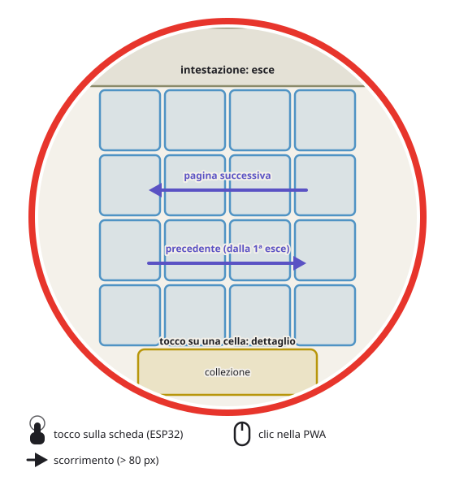
</picture>

Si apre con uno scorrimento orizzontale dalla schermata principale. Griglia 4×4 di celle
da 80 px a partire da (73, 74), 16 Pokémon per pagina, 10 pagine.

| Zona / gesto | Azione |
|---|---|
| Tocco su una cella | dettaglio di quel Pokémon (con lo sprite animato) |
| Tocco sull'intestazione (y < 72) | esce |
| Scorrimento a sinistra | pagina successiva (fino alla 10ª) |
| Scorrimento a destra | pagina precedente; dalla prima esce |
| Nel dettaglio: tocco o scorrimento orizzontale | torna alla griglia |
| **COLLEZIONE** (123–343, 396–452; disegnato 133–333, 400–438) | apre la [collezione](#collezione) |

Gli scorrimenti verticali sono ignorati.

### Collezione

Si apre dal pulsante **COLLEZIONE** della galleria. Cinque caselle da 110×126: tre in alto
da y 80 (x 62, 178, 294), due sotto da y 212 (x 120, 236). Ognuna mostra miniatura, nome,
livello e `*` se shiny; i posti vuoti dicono «VUOTO».

| Zona / gesto | Azione |
|---|---|
| Tocco su una casella occupata | dettaglio: tipi, ATK/DEF/VEL/SPC, livello e allenatore originale, le 4 mosse |
| Tocco sull'intestazione (y < 72) | torna alla galleria |
| Scorrimento orizzontale | torna alla galleria |
| Dettaglio: **RIPRENDI** (70–230, 298–342) | chiede conferma e lo riprende ad allevare; grigio se ora non si può, con il motivo sotto (suono di rifiuto) |
| Dettaglio: **LIBERA** (236–396, 298–342) | chiede conferma e libera il posto |
| Dettaglio: altro tocco o scorrimento orizzontale | torna alla griglia |
| Conferma: **SÌ** (93–227, 268–320) | esegue; dopo RIPRENDI si torna alla schermata principale |
| Conferma: qualunque altro tocco | annulla |

La conferma di RIPRENDI dice cosa succede al pet attivo: l'uovo si perde, oppure la forma
finale prende il posto in collezione. Le regole sono nel [libretto del giocatore](https://francescomannarino.github.io/PokeGotchi/libretto-del-giocatore.pdf), capitolo 17.

## Orologio e impostazioni

<picture>
  <source media="(prefers-color-scheme: dark)" srcset="docs/img/comandi/orologio-scuro.svg">
  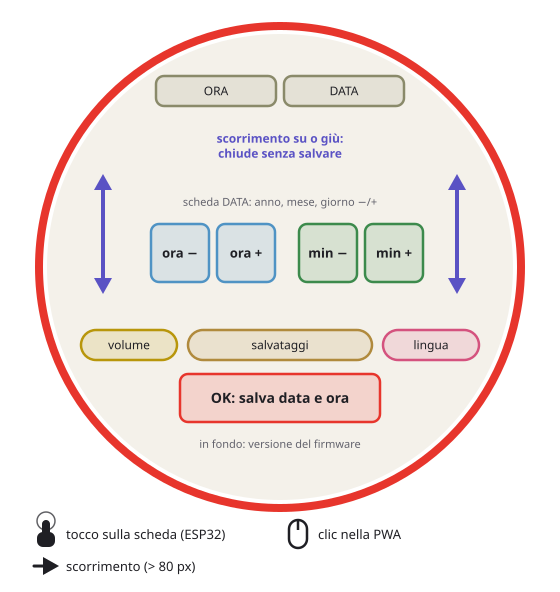
</picture>

Si apre scorrendo verso il basso dalla schermata principale.

| Zona | Azione |
|---|---|
| Scheda ORA (109–229, 42–72) / DATA (237–357) | sceglie cosa cambiano i pulsanti sotto; si apre sempre su ORA |
| ORA: ora − (104–162, 190–248) / ora + (170–228) | ora −1 / +1 (giro su 24) |
| ORA: min − (252–310, 190–248) / min + (318–376) | minuti −1 / +1 (giro su 60) |
| DATA: anno − (43–101, 190–248) / anno + (105–163) | anno −1 / +1 (2025–2099, in giro) |
| DATA: mese − (173–231) / mese + (235–293) | mese −1 / +1 (giro su 12) |
| DATA: giorno − (303–361) / giorno + (365–423) | giorno −1 / +1 (giro sui giorni del mese; cambiando mese o anno scende all'ultimo se serve) |
| Volume (34–130, 296–326) | mostra il volume («VOL 7», «MUTO» a 0) e apre il [pannello Audio](#pannello-audio) |
| Salvataggi (141–325, 296–326) | apre i salvataggi (sotto) |
| Lingua (336–432, 296–326) | lingua successiva (ES, EN, FR, DE, IT, PT, JA, KO) |
| **OK** (133–333, 340–388) | salva data e ora nell'RTC e chiude |
| Pillola della versione (in fondo, y ≥ 414, x 143–323) | apre l'[aggiornamento via WiFi](#aggiornamento-via-wifi) |
| Scorrimento verticale (su o giù) | chiude **senza** salvare data e ora |

La data serve dopo un RTC azzerato: una scheda nuova o rimasta senza batteria riparte
dal 1° gennaio 2026. Si imposta anche dall'installer web (passo 5), che manda quella del
computer. Cambiare data o ora non applica tempo offline al Pokémon.

Volume, musica e lingua cambiano subito, anche se poi chiudi senza OK. Gli scorrimenti
orizzontali e i tocchi fuori dai pulsanti sono ignorati. In fondo la pillola con la
versione del firmware e due frecce in cerchio apre l'aggiornamento.

### Pannello Audio

<picture>
  <source media="(prefers-color-scheme: dark)" srcset="docs/img/comandi/audio-scuro.svg">
  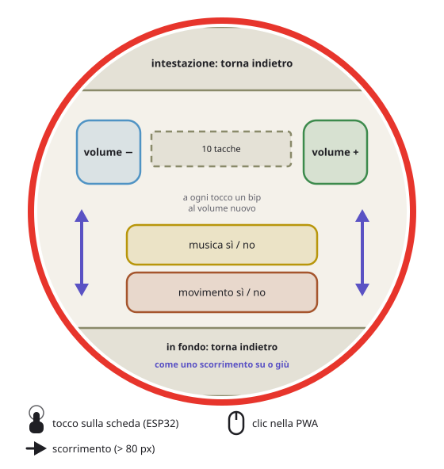
</picture>

| Zona | Azione |
|---|---|
| **−** (50–130, 118–198) / **+** (336–416) | volume −1 / +1 (da 0 a 10); a ogni tocco un bip al volume nuovo |
| Barra (144–320, 132–176) | 10 tacche piene fino al volume, con il numero sotto (o «MUTO») |
| **MUSICA SÌ/NO** (113–353, 250–300) | accende o spegne la musica (battaglie e minigiochi); gli effetti restano |
| **MOVIMENTO SÌ/NO** (113–353, 310–360) | accende o spegne [scossone e colpetti](#scossone-e-colpetti) sulla principale; i giochi a inclinazione usano il sensore comunque |
| Intestazione (y < 80), in fondo (y ≥ 380) o scorrimento verticale | torna alle impostazioni |

Il volume vale per musica ed effetti, a passi di 4 dB; a 0 tutto tace e l'amplificatore
si spegne. Le scelte si salvano subito (chiavi `vol`, `mus` e `mot`, anche nei `.pgsave`).
MOVIMENTO sta qui perché la pagina dell'orologio non ha più posto.

### Schermata dei salvataggi

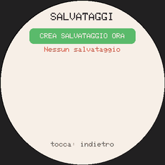

| Zona | Azione |
|---|---|
| **Crea salvataggio ora** (83–383, 80–124) | copia manuale sulla SD in `/save/` |
| Riga dell'elenco (70–396, da 154, 52 px l'una, 4 per pagina) | data, livello e motivo della copia: apre la conferma del ripristino |
| `<` / `>` ai lati (x < 66 / x > 400, 228–276) | pagina precedente / successiva, se le copie sono più di 4 |
| In basso (y ≥ 380) o scorrimento verticale | torna alle impostazioni |

Senza SD la riga di stato lo segnala e le copie automatiche vengono saltate. La conferma
mostra data, motivo, miniatura, nome, livello e Pokédex della copia; **SÌ** (118–218,
336–388) mette da parte lo stato attuale sulla SD, ripristina e riavvia, **NO** (248–348)
lascia tutto com'è. Se il file non è valido compare il motivo, e un tocco chiude.

All'avvio la scheda propone, prima di tutto, un file `/save/importa.pgsave` copiato sulla SD
con un lettore di schede (poi lo rinomina in `importato-<data>.pgsave`, che resta
nell'elenco); con una partita nuova, prima della scelta dell'iniziale, propone il
salvataggio più recente della SD.

### Aggiornamento via WiFi

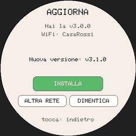

Dalla pillola della versione nelle impostazioni (`SCR_AGGIORNA`). Con una rete ricordata si
collega e controlla l'ultima release da solo; altrimenti elenca le reti. Il WiFi è acceso solo
qui, e mai insieme alla radio del collegamento.

| Momento | Zona | Azione |
|---|---|---|
| Elenco delle reti | una riga (76–390, da y 112, 56 px l'una, 4 per pagina) | sceglie la rete: protetta → tastiera, aperta → si collega |
| Elenco delle reti | `<` / `>` ai lati (x < 76 / x ≥ 390) · sopra l'elenco (y < 112) | pagina precedente / successiva · cerca di nuovo |
| Password | [tastiera completa](#tastiera-completa) | **OK** si collega; la rete si ricorda solo se riesce |
| Connessione fallita | **RIPROVA** (113–353, 262–312) | di nuovo la tastiera (rete protetta) o un altro tentativo |
| Versione nuova | **INSTALLA** (113–353, 262–312) | con batteria ≥ 30 % o USB: salva, scarica, verifica dimensione e SHA-256, riavvia |
| Errore / batteria scarica | **RIPROVA** | controlla di nuovo, o riprova a installare |
| Con una rete | **ALTRA RETE** (62–228, 326–366) · **DIMENTICA** (238–404) | cerca le reti · cancella la rete ricordata |
| Ovunque (non durante lo scaricamento) | in basso (y ≥ 388) | torna alle impostazioni e spegne il WiFi |

Durante lo scaricamento non si esce, lo schermo resta acceso e la partita non scrive la NVS;
alla fine «Fatto! Riavvio...» e la scheda riparte con la versione nuova. Le credenziali stanno
nel namespace NVS `wifi`, fuori dai salvataggi. Nella PWA: «Qui si aggiorna da sola».

#### Tastiera completa

Dieci colonne da 34 px da x 63: una riga di cifre (y 146) e tre righe della pagina
(minuscole, maiuscole, simboli), 44 px l'una. Sotto (y 330–374): il cambio di pagina
(63–133, con l'etichetta della pagina dopo), **___** spazio (137–237), **<-** cancella
(241–301), **OK** (305–403). Il campo in alto (y 88–130) mostra o nasconde il testo; la fascia
in basso (y ≥ 388) annulla. Fino a 63 caratteri, tutto l'ASCII stampabile.

## Scelta dei giochi


Il tocco su ⚽ apre sopra la principale tre caselle da 80×72 px, a y 284–356. Si chiude da sola
dopo 6 s; un tocco fuori la chiude, e gli scorrimenti verticali sono ignorati finché è aperta.

| Zona | Azione |
|---|---|
| Palla (x 113–193) | [minigioco della pokéball](#minigioco-della-pokéball) |
| Grotta (x 193–273), Diglett | [Grotta Diglett](#grotta-diglett) |
| Surf (x 273–353), Pikachu | [Surf](#surf) |

Le icone sono le miniature del Pokédex; senza microSD, un disegno.

### Minigioco della pokéball

<picture>
  <source media="(prefers-color-scheme: dark)" srcset="docs/img/comandi/minigioco-scuro.svg">
  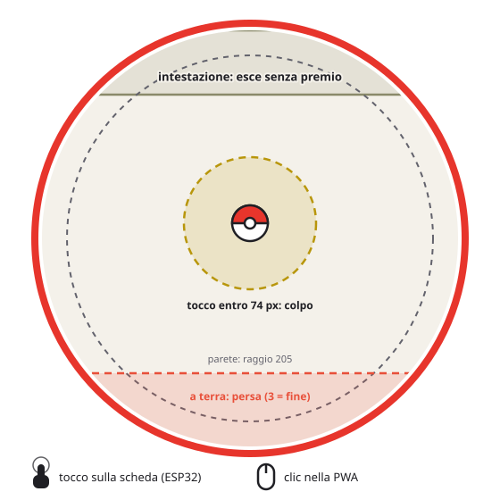
</picture>

Si apre con ⚽. Allena la velocità.

| Zona | Azione |
|---|---|
| Entro 74 px dalla palla | colpo: +1 punto, la palla risale |
| Intestazione (y < 72) | esce senza premio |

- La palla rimbalza sul bordo del cerchio (raggio 205) e cade sempre più veloce.
- Quando tocca terra (y > 384) è persa; alla terza la partita finisce e il risultato resta
  a schermo 4 s, durante i quali i tocchi sono ignorati.
- Gli scorrimenti sono ignorati.

### Giochi a inclinazione

La Grotta Diglett e il Surf si giocano inclinando la scheda (accelerometro QMI8658). Comandi
comuni:

- **Zero**: per 1,5 s, «tienila come per giocare». L'inclinazione si misura da lì, quindi si
  gioca anche sdraiati. Zona morta 2°, piena a 25°, passa-basso di 100 ms.
- **Joystick**: senza sensore (PC, PWA sul desktop, permesso negato su iOS) il dito tenuto
  fa da inclinazione: direzione e distanza dal centro, piena a 150 px, zona morta 8 px.
- **Intestazione** (y < 72): esce senza premio. Gli scorrimenti sono ignorati.
- Mentre si gioca lo schermo non si attenua, anche se nessuno lo tocca.
- Il pet ha una hitbox fissa di 26 px, uguale per tutte le specie: il record si confronta.
- A fine partita la seriale stampa una riga di riepilogo (`GROTTA …` / `SURF …`, con il
  fotogramma più lento in `render=`).

#### Grotta Diglett


Il pet scivola nell'arena rotonda (raggio 205, rimbalza sul bordo) verso il lato inclinato.

| Cosa | Effetto |
|---|---|
| Bacca (dura 6 s) | +1 punto |
| Caramella Rara (ogni ~20 s, dura 6 s) | +5 punti |
| Diglett: la terra trema 1 s, poi spunta per 1,2 s | un colpo se il pet è sopra |
| Frana (da 5 punti): un'ombra cresce per 1,2 s, poi cade il masso | un colpo se il pet è nell'ombra |
| Dugtrio (da 15 punti): tre buche in fila | come il Diglett |

I pericoli arrivano ogni 2,6 s, fino a 0,8 s con il punteggio. Dopo un colpo il pet lampeggia
ed è invulnerabile per 1 s; al terzo, o dopo 90 s, la partita finisce. Premio: DIFESA +punti/4
(al massimo +18 a partita, fermo a 100), felicità +5 +punti (al massimo +30), fatica e peso
bruciato, un cuore da 10 punti, legame. Musica: Dungeon2.

#### Surf


Il pet sta a un terzo dello schermo su una tavola; l'onda scorre verso sinistra.

| Inclinazione | Effetto |
|---|---|
| In avanti (lato alto che si allontana) | spinge in discesa, più velocità |
| All'indietro | frena |
| Destra / sinistra, in aria | la tavola gira |

Si salta dalla cresta dell'onda lunga, se si va abbastanza veloci; più si va veloci, più si
resta in aria. Si atterra se la tavola è entro **±25°** dalla pendenza dell'onda (**±40°** e
tavola gialla per Pikachu, Raichu e i tipi Acqua), se no si cade. Un salto vale 1 punto + 2 per
ogni giro completo; dopo 3 cadute, o 90 s, la partita finisce. Premio come la Grotta, senza
statistica; un record unico per tutte le specie. Musica: Surfing Pikachu.

## Scossone e colpetti


Sulla scheda, fuori dai giochi. Il sensore è in VEGLIA solo sulla **schermata principale**,
con lo schermo acceso o attenuato e MOVIMENTO acceso ([pannello Audio](#pannello-audio));
altrove, e con lo **schermo spento dal PWR**, è spento: in tasca la scheda prende colpi.

| Evento | Effetto |
|---|---|
| Scossone (due picchi sopra 2,5 g entro 0,8 s) | il pet si fa male: −10 felicità, «!», suono di rifiuto; poi 60 s senza altre penalità (il «!» resta). Nel sonno −5 e resta addormentato; l'uovo oscilla. Riaccende lo schermo attenuato |
| Doppio colpetto sulla scocca | con lo schermo attenuato lo riaccende; acceso, il pet smette di passeggiare, fa un cenno o un saltello e compare un «?». Nessuna statistica. Nel sonno solo lo schermo; l'uovo oscilla |

- Valgono solo senza menu aperti (cibo, giochi, dialoghi). Nella palla e nel sacco il sensore
  è spento: il dito batte sul vetro.
- Un evento entro 300 ms da un tocco, prima o dopo, si scarta: è il dito.
- Nessuno dei due tocca il ciclo di vita. La seriale stampa `MOTO scossone gioia=-n pausa=0|1`.
- Senza scocca non scuotere la scheda con la LiPo attaccata.

## Sacco da allenamento

<picture>
  <source media="(prefers-color-scheme: dark)" srcset="docs/img/comandi/sacco-scuro.svg">
  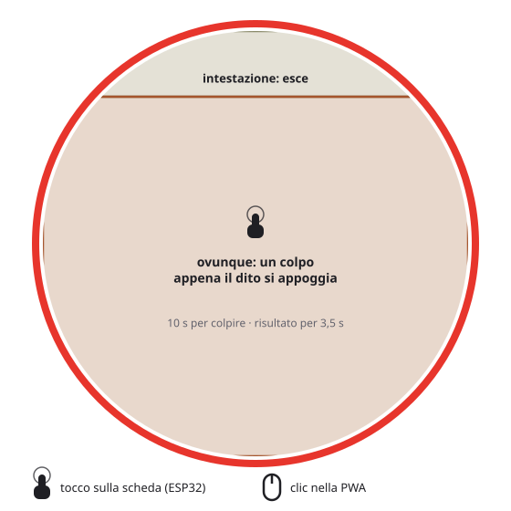
</picture>

Si apre dalla scheda (pagina Lotta → «Allena forza»). Allena la forza.

| Zona | Azione |
|---|---|
| Ovunque sotto l'intestazione | un colpo, appena il dito si appoggia |
| Intestazione (y < 72) | esce |

Hai 10 s per colpire il più possibile; il risultato resta a schermo 3,5 s. Gli
scorrimenti sono ignorati.

## Battaglia

Si apre dalla scheda (pagina Lotta → «Lotta»). L'avversario è un Pokémon selvatico casuale
del bioma del tuo (lo sfondo), di livello vicino: da 2 sotto a 1 sopra il livello di
battaglia, che è quello del pet fino a 100. Niente leggendari, e niente forme evolute prima
del livello a cui si evolvono. Si combatte 1 contro 1 con le regole di Rosso/Blu (vedi il
libretto del giocatore, capitolo 16).

Non si lotta da uovo, mentre dorme, durante un'evoluzione o una cerimonia, né con l'energia
sotto 20: il pulsante è grigio.

| Momento | Zona / gesto | Azione |
|---|---|---|
| Testo | tocco ovunque | riga successiva (quando la riga e le animazioni sono finite) |
| Menu | «Lotta» (70–228, 290–352) | griglia delle mosse; senza PP, Scontro direttamente |
| Menu | «Pokémon» (238–396, 290–352) | la squadra: nome, livello, PS, stato; in campo ha il bordo verde, KO è grigio |
| Menu | «Fuga» (154–312, 360–408) | fugge (riesce sempre); nel [collegamento](#battaglia-in-collegamento) è una resa, con conferma |
| Mosse | una mossa (2×2, 162×52 da 67/235, 284/342) | la usa; senza PP: un suono di rifiuto |
| Mosse | freccia (163–303, 404–448) o metà alta (y < 280) | torna al menu |
| Squadra | una riga (63–403, 70 alte da y 112, ogni 78) | nel collegamento manda in campo quel Pokémon (è il turno); contro la CPU c'è solo il pet: suono di rifiuto |
| Squadra | freccia (163–303, 404–448) o titolo (y < 72) | torna al menu |

Gli scorrimenti e la pressione lunga sono ignorati. Una cerimonia che parte chiude la
battaglia e conta come una fuga (nel collegamento: si esce dalla lotta e la radio si spegne).

Per tutta la battaglia suona la musica dei selvatici di Rosso/Blu (nel collegamento quella
degli allenatori); alla vittoria la sua fanfara, mentre sconfitta, pareggio e fuga la
fermano. Con MUSICA spenta (pannello
[Audio](#pannello-audio)) restano gli effetti; con lo schermo spento dal PWR tutto tace.

**Costi e premi** (`Pet::battleResult` in `pet.cpp`):

| Esito | Effetto |
|---|---|
| Ogni battaglia | −12 energia, −6 sazietà (fino a un minimo di 5) |
| Fuga | solo −4 energia, −2 sazietà |
| Vittoria premiata | +15 felicità, +2 FORZA, +2 DIFESA di allenamento, +3 legame, cuore |
| Vittoria oltre il limite | +3 felicità e la riga «Per oggi niente premi» |
| Sconfitta | −8 felicità (fino a 5) |
| Pareggio | solo il costo |

- Al massimo **5 vittorie premiate al giorno** (giorno dell'orologio); il contatore si salva
  con lo stato e sopravvive al riavvio. Senza orologio impostato vale come un solo giorno.
- Mai effetti sul ciclo di vita: età, trascuratezze, evoluzione, addio e fuga non cambiano.
  I PS non restano: ogni battaglia comincia a PS pieni.
- Il risultato si salva in differita, come il tick (`savePending()`), quando lo schermo si
  attenua; la battaglia non conta come cura del giorno per la serie.
- Il comando seriale `BATTLE <dex> [lvl]` (con `DEBUG ON`) avvia una battaglia di prova,
  senza costi né premi.

## Tastiera del nome

<picture>
  <source media="(prefers-color-scheme: dark)" srcset="docs/img/comandi/tastiera-scuro.svg">
  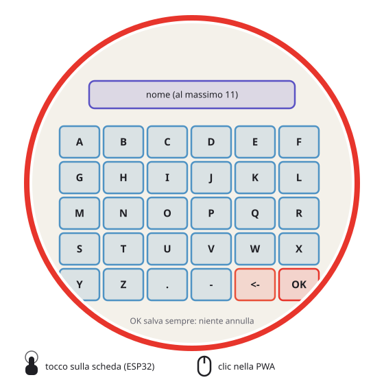
</picture>

Si apre dalla scheda, toccando il nome nella pagina Profilo, e al primo collegamento per il
nome dell'allenatore («NOME ALLENATORE»: vuoto non si accetta, OK apre il collegamento).
Griglia di 6 colonne × 5
righe di tasti da 64×52 px a partire da (40, 150).

| Tasto | Azione |
|---|---|
| A–Z, `.`, `-` | aggiunge la lettera (al massimo 11 caratteri) |
| `<-` (penultimo) | cancella l'ultima lettera |
| `OK` (ultimo) | salva il nome e torna alla scheda |

Non c'è un tasto per annullare: OK salva sempre quello che c'è nel riquadro. Gli
scorrimenti sono ignorati.

## Pulsante PWR

| Pressione | Azione |
|---|---|
| Breve | schermo spento / acceso (il gioco continua a girare) |
| Lunga (4 s) | spegnimento completo, gestito dalla PMU AXP2101 |

L'RTC resta alimentato anche da spento: alla riaccensione il tempo trascorso viene
applicato alla creatura. Con lo schermo spento basta anche un tocco per riaccenderlo.

## Console seriale

USB, 115200 baud, un comando per riga. Ogni comando risponde `DONE` (o `ERR …`).

> [!WARNING]
> I comandi di debug modificano la partita e alcuni sono **distruttivi**: `WIPE YES`
> cancella tutta la NVS (creatura, Pokédex, medaglie) e riavvia, `SPEC`/`LVL`/`BYE`/`RUN`
> cambiano la creatura. Rispondono `ERR` finché non invii `DEBUG ON`, che vale fino al
> riavvio. La porta è la stessa che usa l'installer web.

<details>
<summary><b>Informazioni</b> (sempre attivi)</summary>

| Comando | Effetto |
|---|---|
| `STATS` | stato completo: specie, livello, statistiche, peso, geni, medaglie, batteria, RTC |
| `HEALTH` | uptime, heap libero e minimo, PSRAM libera, SD e sprite caricati (per il soak test), motivo dell'ultimo riavvio (`rst=ACCESO`, `CRASH`, `WATCHDOG`, `USB`…) |
| `PWR` | come la pressione breve del pulsante PWR: schermo spento / acceso |
| `TOCCHI` | accende / spegne il registro dei gesti: ogni tocco e scorrimento riconosciuto stampa coordinate e schermata (`GESTO tocco x y scr=n`), e nel collegamento anche lo stato (`LINKTAP …`). Fino al riavvio |
| `REG` | Pokédex: quanti registrati e quali |
| `TIME` | legge l'RTC (epoch) |
| `TIME <epoch>` | imposta data e ora (epoch dell'ora **locale**, dal 2025) come l'OK dell'orologio, senza tempo offline; lo usa l'installer web |
| `EGGS` | simula 20 tiri di uovo, senza cambiare la partita |
| `BEEP` | prova dell'audio |
| `MOTO [SPENTO\|VEGLIA\|GIOCO]` | sensore di movimento: presenza, indirizzo I2C (`0x6B`), modo, campioni letti e persi, errori I2C, scossoni e colpetti contati; poi per 5 s una riga `moto g x= y= z=` ogni 250 ms (gravità in g negli assi dello schermo: x a destra, y in basso, z uscente; in piano −1) e una riga per ogni evento (`SCOSSONE`, `COLPETTI`), infine di nuovo lo stato e `DONE`. Senza modo, un sensore spento si accende in GIOCO per i 5 s; con il modo, quello vale per i 5 s, poi il gioco rimette il suo (VEGLIA sulla principale, GIOCO nei giochi a inclinazione, altrimenti SPENTO). Per quei 5 s gli eventi li prende la console, non il pet. Nell'emulatore il sensore finto si muove con I/J/K/L, Z (scossone) e C (doppio colpetto) |
| `AUDIO` | uscita audio: frequenza (`fs=32000`, o `16000(riserva)`), volume, MUSICA, amplificatore, campioni per blocco, carico del task e blocco più lento dall'ultimo `AUDIO`, blocchi prodotti e in ritardo |
| `OTA` | aggiornamento: versione, repository, URL del manifest, stato del WiFi, rete ricordata |
| `LINK` | collegamento (schermata COLLEGA): radio accesa, stato del protocollo, motivo della fine, MAC; con un peer agganciato il suo MAC, firmware, versione del protocollo, hash, allenatore, specie, codice e conferme; poi firmware e hash propri, `trainerId`, pacchetti scartati e ritrasmessi, heap; infine la riga `LINKB` della battaglia in collegamento: fase, host, regola, passo, motivo, passi corretti dall'host (`desync`, deve restare 0), pacchetti scartati e persi, vittorie in collegamento; e la riga `LINKS` dello scambio: fase (LIBERO, OFFERTA, PREPARATO, SOSPESO, FATTO), motivo, le due offerte (con il posto offerto, −1 = il pet attivo), le accettazioni, `tradeId`, giornale, pet bloccato, scartati, persi e scambi effettuati; con un giornale anche partner, nome, posto e le due specie |
| `COL` | collezione: un posto per riga (specie, livello, shiny, nome, allenatore, codice di RIPRENDI: 0 = possibile), poi quanti posti e se la domanda di fine cerimonia è aperta |
| `EXPORT` | stampa il salvataggio attuale (`.pgsave`) in base64 su una riga |
| `BACKUP` | crea subito una copia sulla SD in `/save/` e ne stampa il percorso |
| `IMPORT <base64>` | verifica un salvataggio (`CONFERMA <specie> <livello>` o `ERR <motivo>`); lo scrive solo dopo il **SÌ** sullo schermo, poi `DONE` e riavvio |

</details>

<details>
<summary><b>Debug</b> (dopo <code>DEBUG ON</code>)</summary>

| Comando | Effetto |
|---|---|
| `DEBUG ON` | sblocca i comandi qui sotto fino al riavvio |
| `SPEC <dex>` | cambia specie (1–151) |
| `LVL <n>` | imposta il livello (età = n ore di gioco) |
| `HATCH` | schiude l'uovo |
| `SHINY` | alterna la forma shiny |
| `NICK <nome>` | rinomina |
| `TOCCA x y` · `SCORRI SU\|GIU\|SINISTRA\|DESTRA` · `CASA` | un tocco o uno scorrimento come il dito, con le coordinate dello schermo 466×466 (come il copione dell'emulatore), e il ritorno alla schermata principale: per guidare le prove dalla seriale |
| `BARRE <cibo> <gioia> <energia> <igiene>` | imposta le quattro barre (0–100) e azzera l'incuria in corso |
| `CAREDAY` | simula un nuovo giorno di cure (serie, legame, medaglie) |
| `BYE` | avvia la cerimonia dell'addio |
| `RUN` | avvia la fuga |
| `ABANDON` | porta la creatura allo stato «pronta a fuggire» (per provare il pulsante) |
| `GAL` | apre / chiude la galleria |
| `BATTLE <dex> [lvl]` | battaglia di prova contro un selvatico, senza costi né premi (livello 1–100; senza, quello del pet fino a 100); non da uovo né in cerimonia |
| `RTCSET <epoch>` | imposta solo l'RTC (per simulare uno spegnimento) |
| `COLADD` | mette il pet attivo nella collezione senza cerimonia e fa nascere un uovo (`ERR` da uovo, in cerimonia o con la collezione piena) |
| `COLSI [posto]` | risponde **sì** alla domanda di fine cerimonia; con la collezione piena serve il posto (0–4) da liberare |
| `COLNO` | risponde **no** alla domanda di fine cerimonia: nasce l'uovo |
| `WIFI <ssid> [password]` · `WIFI OFF` | ricorda una rete (ssid senza spazi; la password può averne) · la dimentica |
| `OTA URL [url]` | manifest di prova fino al riavvio (anche `http://` sulla LAN); senza url torna a quello delle release |
| `AGGIORNA` | apre la schermata dell'aggiornamento |

</details>

<details>
<summary><b>Reset di fabbrica</b> (distruttivi, dopo <code>DEBUG ON</code>)</summary>

| Comando | Effetto |
|---|---|
| `WIPE` | non fa nulla: chiede la conferma con `WIPE YES` |
| `WIPE YES` | reset di fabbrica: cancella la NVS, riavvia, nuova partita con la scelta dell'iniziale |

</details>

<details>
<summary><b>Protocollo SD</b> (sempre attivo; usato da <code>send_sd.py</code> e dall'installer)</summary>

| Comando | Effetto |
|---|---|
| `LS` | elenca i file della microSD |
| `SDINFO` | diagnostica della microSD (per «non mi riconosce la SD») |
| `PUT <percorso> <byte>` + dati grezzi | scrive un file sulla SD (massimo 4 MB); risponde `OK` … `DONE` |

La microSD deve essere in FAT32: il firmware non la formatta mai.

</details>

## Salvataggi

Un salvataggio è un file `.pgsave`: la copia di tutte le chiavi del gioco nella NVS
(namespace `pokegotchi`), cioè creatura, età, geni, allenamento, nome, legame, Pokédex,
serie, medaglie, lingua, volume e musica. L'intestazione riporta la versione del firmware, la data,
il motivo della copia e un riassunto (specie, livello, shiny, nome, specie nel Pokédex);
un CRC32 protegge il contenuto. Il formato, byte per byte, è descritto in testa a
[`savefile.h`](savefile.h).

Un file con uno schema dei dati più recente del firmware viene rifiutato («aggiorna il
firmware»); quelli più vecchi si importano sempre e `load()` li migra. Dalla 1.19 lo stato
della creatura sta in un'unica voce `st` (layout in [`pet.h`](pet.h), `PetSave`) invece che
in chiavi separate: i file della 1.17 e della 1.18 si importano e vengono convertiti, mentre
una 1.18 rifiuta i file nuovi (schema 2). Il tempo è **congelato**: i minuti passati tra la
copia e il ripristino non contano.

### Sulla scheda

- **Impostazioni → Salvataggi** ([sopra](#schermata-dei-salvataggi)): crea una copia,
  sfoglia le copie sulla SD e ripristinane una. Prima di ripristinare, lo stato attuale
  viene messo da parte sulla SD, così un ripristino sbagliato si annulla.
- **All'avvio**: un file `/save/importa.pgsave` viene proposto per primo; con una partita
  nuova, prima della scelta dell'iniziale, viene proposta la copia più recente della SD.
- **Console seriale**: `EXPORT`, `IMPORT <base64>` e `BACKUP` (vedi la
  [console](#console-seriale)). `IMPORT` scrive solo dopo il **SÌ** sullo schermo.

### File sulla microSD

Le copie stanno in `/save/` e sopravvivono al riflash con «Erase device».

| Nome | Quando |
|---|---|
| `AAAAMMGG-HHMMSS-manuale.pgsave` | «Crea salvataggio ora» o `BACKUP` |
| `…-giornaliera.pgsave` | una al giorno, alla prima attenuazione dello schermo dopo il cambio di data |
| `…-aggiornamento.pgsave` | al primo avvio di un firmware diverso, prima che i dati vengano migrati |
| `…-importazione.pgsave` | lo stato attuale, subito prima di un ripristino o di un `IMPORT` |
| `…-scambio.pgsave` | lo stato attuale, subito prima di uno [scambio](#scambio-in-collegamento) (scritta anche a schermo acceso) |
| `importa.pgsave` | copiato da te con un lettore di schede: proposto all'avvio, poi rinominato in `importato-AAAAMMGG-HHMMSS.pgsave` |

Si tengono le 10 copie più recenti, più sempre l'ultima di ogni motivo. Le copie si
scrivono solo a schermo attenuato. Senza SD le copie automatiche vengono saltate e le
impostazioni lo segnalano.

### Dal computer

- **[Installer web](#installer-web)**, in Chrome/Edge: «Scarica i progressi» salva un
  `.pgsave` dalla scheda, «Carica i progressi» lo rimanda (con la conferma sullo schermo).
  Il flusso di installazione li propone prima e dopo il flash.
- **`tools/salvataggi.py`**, dal terminale:

  ```bash
  python3 tools/salvataggi.py esporta -o mio.pgsave   # EXPORT dalla scheda
  python3 tools/salvataggi.py importa mio.pgsave      # IMPORT, poi SÌ sullo schermo
  python3 tools/salvataggi.py info mio.pgsave         # intestazione, chiavi e CRC, senza scheda
  ```

### PWA (versione per browser e telefono)

La partita resta nel browser (IndexedDB) e si salva da sola a ogni azione e quando la pagina
va in secondo piano. Usa lo stesso formato `.pgsave`: un salvataggio della scheda si apre
nella PWA e viceversa. Il pulsante con il dischetto, in basso a sinistra fuori dallo
schermo, apre i salvataggi:

- **Esporta salvataggio**: sullo smartphone apre il foglio di condivisione (salvalo in File
  o Drive, o mandalo a te stesso), sul computer scarica il file.
- **Importa da file**: proposto anche al primo avvio, sotto la scelta dell'iniziale. Prima
  di sovrascrivere chiede conferma e mette da parte la partita attuale.
- **Copie automatiche**: le ultime 3, in questo browser: una al giorno, una quando il gioco
  si aggiorna e una prima di ogni importazione. «Ripristina» ne riprende una.
- **Porta dalla scheda / Porta sulla scheda**: in Chrome o Edge sul computer, con la scheda
  collegata via USB (Web Serial, comandi `EXPORT`/`IMPORT`). Sulla scheda si conferma sul
  suo schermo.
- **Promemoria**: se non esporti da 7 giorni compare un pallino rosso sul dischetto. Su
  iPhone e iPad Safari può cancellare i dati di un sito non installato: aggiungi PokeGotchi
  alla schermata Home ed esporta ogni tanto.

Per portare sulla scheda un salvataggio della PWA senza Web Serial (per esempio da uno
smartphone), copialo sulla SD come `/save/importa.pgsave`. Al primo avvio la PWA usa la
lingua del browser, se è tra quelle del gioco. La schermata «Salvataggi» delle impostazioni
del gioco funziona come sulla scheda: le sue copie stanno in una SD finta, salvata nel
browser insieme alla partita, e sono distinte dalle 3 del pannello.

#### Installazione, sprite e aggiornamenti

La PWA si apre dal link «Gioca nel browser» dell'[installer web](#installer-web).

- **Installare**: in Chrome/Edge «Installa app» nella barra dell'indirizzo; su Android
  «Aggiungi a schermata Home» (o «Installa»); su iPhone e iPad Condividi → «Aggiungi alla
  schermata Home». Si apre a tutto schermo, in verticale.
- **Sprite**: arrivano quando servono, uno alla volta, e restano nel browser. Finché uno
  sprite non è arrivato si vede quello semplice incorporato nel gioco; nel Pokédex e in
  battaglia lo sprite nuovo compare alla prossima apertura.
- **Giocare offline**: «Scarica gli sprite per giocare offline», sotto lo schermo, li
  scarica tutti (~40 MB) con una barra di avanzamento; se si interrompe, «Completa gli
  sprite» riprende da dove era rimasto. Il pulsante sparisce quando ci sono tutti.
- **Aggiornamenti**: una versione nuova si scarica da sola quando torni sul gioco e
  compare «Nuova versione pronta · Aggiorna». Aggiornare ricarica la pagina senza toccare la
  partita né gli sprite; senza toccare il pulsante, la versione nuova parte alla prossima
  apertura dopo aver chiuso il gioco.
- **Suono**: musica ed effetti sono quelli della scheda, dallo stesso motore, con lo stesso
  pannello Audio (volume e MUSICA si salvano con la partita). L'audio parte al primo tocco
  sullo schermo o sul PWR (prima i browser non lasciano suonare una pagina), si ferma quando
  la pagina va in secondo piano e riprende al ritorno. Con `?debug`, `AUDIO` mostra la
  frequenza del browser (di solito `fs=48000`) e `amp=1` mentre l'audio è acceso.
- **Console di debug**: aggiungi `?debug` all'indirizzo (`…/gioca/?debug`) per un pannello
  con la [console seriale](#console-seriale): `STATS`, `HEALTH`, `DEBUG ON`, `SPEC 25`…
  Dalla console del browser funziona anche `pokegotchi.seriale('STATS')`.

#### Limiti

- Nessun avanzamento in background né notifiche: il gioco recupera il tempo alla
  riapertura, come la scheda dopo lo spegnimento.
- Su iOS, la scheda di Safari e l'app sulla schermata Home hanno archivi separati: conviene
  installare subito ed esportare ogni tanto, perché i siti non installati possono perdere i
  dati dopo giorni di inattività.
- Niente collegamento tra dispositivi (battaglie e scambi): la radio c'è solo sulla scheda.
- Movimento: il sensore è quello del telefono (DeviceMotion, compensato per la rotazione
  dello schermo). Su iOS il permesso si chiede al primo tocco e solo in `https` (GitHub Pages
  sì, `http://<IP del PC>` no); negato, o sul desktop, i giochi a inclinazione usano il
  joystick. C'è lo scossone ma non il doppio colpetto, che il telefono non distingue da un
  tocco.
- Audio: su iPhone e iPad l'interruttore del silenzioso zittisce la pagina, e niente suona
  in background, nemmeno nell'app installata. Dopo una telefonata o un'altra app che usa
  l'audio, il suono torna al primo tocco. Da un indirizzo non sicuro (`http://<IP del PC>`,
  non `localhost` né `https`) il browser non offre l'AudioWorklet: la PWA usa un'uscita di
  riserva, con più ritardo e qualche scatto se il telefono è lento.

> [!WARNING]
> **Cloni.** Un salvataggio si può ripristinare quante volte vuoi, anche su più schede:
> ripristinare una copia fatta prima di uno scambio fa ricomparire il Pokémon ceduto.
> Senza un server non si può impedire; PokeGotchi è un gioco per uso personale e lo accetta.

## Installer web

L'[installer web](https://francescomannarino.github.io/PokeGotchi/installa/) funziona in **Chrome/Edge**
desktop (Web Serial), da HTTPS o `localhost`.

1. **Salva i progressi**: se la scheda ha già un Pokémon, «Scarica i progressi» ne salva
   un `.pgsave` sul computer. Consigliato prima di ogni flash, indispensabile con «Erase
   device».
2. **Flasha il firmware**. Per una scheda nuova spunta «Erase device»; per un aggiornamento
   non serve, e il Pokémon resta.
3. **Ripristina i progressi**: se hai cancellato la scheda, «Carica i progressi» rimanda il
   file del passo 1; conferma con **SÌ** sullo schermo e la scheda si riavvia.
4. **Carica gli sprite**: scarica `sprites.pak` e lo copia sulla microSD via USB, con il
   protocollo `PUT`.

La porta la può usare un solo programma alla volta: chiudi la finestra del flash prima dei
passi 3 e 4. Con «sceglili a mano» puoi inviare i tuoi file `.bin`. La sezione
«Salvataggi» della pagina scarica e carica i progressi anche fuori dal flusso di
installazione (vedi [Salvataggi](#salvataggi)). Dettagli in [`web/README.md`](web/README.md).

<details>
<summary><b>Note dal codice</b> (casi limite, utili per diagrammi e PWA)</summary>

- La pressione lunga non controlla se è aperto il minigioco: tenere il dito fermo 3 s
  sulla zona della creatura durante una partita prepara il dialogo «rilasciare?», che
  compare dopo, se la partita finisce entro 10 s.
- Nel menu del cibo il pixel x = 365 dà la voce 4, che non esiste; è trattata come una
  bacca che la creatura non preferisce.
- Lo scorrimento orizzontale apre la galleria anche con il menu del cibo o un dialogo di
  scelta aperti, e quelli verticali aprono scheda e orologio con un dialogo di scelta
  aperto: il dialogo resta sotto e scade da solo.

</details>
