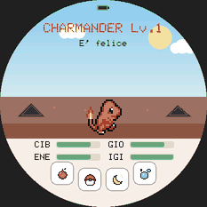
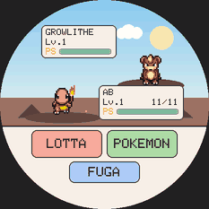
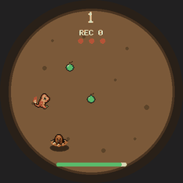
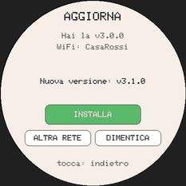

# PokeGotchi

[](https://github.com/francescomannarino/PokeGotchi/actions/workflows/ci.yml)
[](https://github.com/francescomannarino/PokeGotchi/releases/latest)
[](https://francescomannarino.github.io/PokeGotchi/gioca/)
[](https://francescomannarino.github.io/PokeGotchi/libretto-del-giocatore.pdf)


Un tamagotchi con i 151 Pokémon della prima generazione, per lo schermo rotondo della
**Waveshare ESP32-S3-Touch-AMOLED-1.75**, nel browser e sul telefono.

| | | | |
|:-:|:-:|:-:|:-:|
|  |  |  |  |
| Casa | Battaglia | Grotta Diglett | Aggiornamento via WiFi |

**[🎮 Gioca nel browser](https://francescomannarino.github.io/PokeGotchi/gioca/)** ·
**[⚡ Installa sulla scheda](https://francescomannarino.github.io/PokeGotchi/installa/)** ·
**[📖 Il libretto del giocatore (PDF)](https://francescomannarino.github.io/PokeGotchi/libretto-del-giocatore.pdf)** ·
**[🌐 Il sito](https://francescomannarino.github.io/PokeGotchi/)**

## Com'è nato

Volevo un piccolo compagno da tenere sulla scrivania, con i Pokémon con cui sono cresciuto.
Ho trovato [socquique/TamaPoke](https://github.com/socquique/TamaPoke) di Quique Tortosa: i
151 animati con gli sprite di PMD SpriteCollab, un ciclo di vita, un installer da browser.
Un ottimo punto di partenza. Sono partito dalla sua versione 1.17 e ho continuato a
chiedermi «e se…?»: e se potesse combattere come in Rosso e Blu? E se due schede potessero
lottare e scambiarsi i Pokémon? E se suonasse le musiche del Game Boy? E se si giocasse
inclinandolo? E se girasse anche sul telefono?

Qualche mese e molte versioni dopo, il progetto era diventato un'altra cosa, e gli ho dato un
nome suo: **PokeGotchi**.

## Cosa c'è

Il tuo Pokémon cresce con il tempo vero (un minuto è un minuto, un'ora è un livello), ha
quattro bisogni da curare, si evolve quando decidi tu e un giorno ti saluta lasciandoti un
uovo nuovo: comune, raro, leggendario, magari shiny. Tutto il resto l'ho costruito io sopra
la base originale:

- **Salvataggi che non si perdono** — un formato `.pgsave` con CRC e versione, copie
  automatiche sulla microSD con rotazione, ripristino con conferma, l'installer che salva
  prima del flash e ripristina dopo.
- **Battaglie della prima generazione** — danni, stati, mosse e intelligenza della CPU di
  Rosso e Blu, con i dati presi dal disassemblaggio del gioco originale.
- **Collegamento tra due schede** — via ESP-NOW, senza internet: lotte a squadre da tre
  con la regola della coppa, e scambi (Kadabra, Machoke, Graveler e Haunter si evolvono
  appena arrivano).
- **Collezione** — cinque posti per i compagni migliori, da riprendere o portare in squadra.
- **Le musiche del Game Boy** — un'APU emulata e il motore audio di Rosso e Blu riscritto
  nota per nota: battaglie, vittorie, la Grotta Diglett con la batteria, Surfing Pikachu.
- **Minigiochi a movimento** — la Grotta Diglett e il Surf si giocano inclinando la scheda;
  il Pokémon si spaventa se la scuoti e ti guarda se bussi.
- **Nel browser e sul telefono** — lo stesso firmware compilato in WebAssembly: una PWA
  installabile e offline, con gli stessi salvataggi. Più un emulatore per PC.
- **Aggiornamenti via WiFi** — la scheda scarica da sola le release di GitHub, con una
  tastiera completa per la password del WiFi.
- **Il libretto del giocatore** — un manuale da stampare in stile anni '90, che spiega tutto
  il gioco (lo trovi sopra, ed è allegato a ogni release).

### Sotto il cofano

La parte di cui vado più fiero non si vede:

- **Un Game Boy a banda limitata**: i quattro canali dell'APU in aritmetica intera, con la
  sintesi a banda limitata (l'idea di Blip_Buffer) e il passa-alto del DMG, a 32 kHz su un
  task del secondo core.
- **Memoria spremuta**: gli oggetti grandi vivono nella PSRAM, e la radio del collegamento
  usa il solo driver del WiFi: oltre 250 KB di RAM interna liberi a riposo.
- **Lotte in collegamento senza disaccordi**: una scheda fa da arbitro, l'altra ripete ogni
  turno su una copia della battaglia con lo stesso seme. Provato su un canale simulato che
  perde, duplica e riordina i pacchetti.
- **Scambi atomici**: un giornale nella memoria non volatile rende ogni scambio
  tutto-o-niente, anche spegnendo una scheda a metà.
- **Sensore e touch sullo stesso bus I2C**: l'accelerometro letto ogni 8 ms da un task, con un
  mutex attorno a ogni transazione: zero letture corrotte.
- **Aggiornamenti sicuri**: il firmware nuovo va nella partizione libera e si avvia solo se
  dimensione e SHA-256 coincidono con il manifest della release.
- **Uno strato hardware (HAL)** che separa il gioco dalla scheda: così lo stesso codice gira
  sulla scheda, nell'emulatore e nel browser.
- **Oltre 400 test automatici**, anche con AddressSanitizer, più uno smoke test che gioca 48
  ore accelerate nell'emulatore fotografando ogni schermata. La CI li esegue a ogni push.

## Iniziare

**Con la scheda.** Ti servono la Waveshare ESP32-S3-Touch-AMOLED-1.75 (standard o «-G», non
la «-B»), una microSD in FAT32 e, se vuoi, una LiPo da 3,7 V e un altoparlantino. Apri
l'**[installer](https://francescomannarino.github.io/PokeGotchi/installa/)** in Chrome o Edge,
collega la scheda e segui i cinque passi: flash, sprite sulla microSD, data e ora. Da lì in
poi si aggiorna da sola, dalle impostazioni.

**Senza scheda.** Apri la **[versione per il browser](https://francescomannarino.github.io/PokeGotchi/gioca/)**
e, se vuoi, installala sulla schermata Home del telefono.

**Per imparare a giocare** c'è il
**[libretto del giocatore](https://francescomannarino.github.io/PokeGotchi/libretto-del-giocatore.pdf)**:
60 pagine A5, stampabili anche a libretto su A4, con tutte le regole e i numeri veri del
gioco. Ogni gesto e comando, schermata per schermata, è anche in [`COMANDI.md`](COMANDI.md).

## Per chi sviluppa

Il firmware è uno sketch Arduino per ESP32-S3; gli strumenti sono in Python; l'emulatore e la
PWA si compilano sul PC. Architettura, comandi, test, convenzioni e il processo di release
sono in **[`docs/SVILUPPO.md`](docs/SVILUPPO.md)**.

```bash
bash tools/prepara_arduino.sh          # core ESP32 e librerie, alle versioni provate
bash tools/build_firmware.sh           # firmware e file della release in dist/
bash test/run_tests.sh                 # i test, senza scheda
cd tools/emu && make && ./build/pokegotchi   # il gioco sul PC (SDL2)
```

Le release le fa la CI con [release-please](https://github.com/googleapis/release-please) a
partire dai commit in formato *conventional commits*; la cronologia è nel
[`CHANGELOG.md`](CHANGELOG.md).

## Ringraziamenti

PokeGotchi esiste grazie al lavoro di altri. Grazie di cuore a:

- **[socquique/TamaPoke](https://github.com/socquique/TamaPoke)** di **Quique Tortosa** — il
  progetto originale da cui tutto è partito: firmware, pipeline degli sprite PMD, installer
  web e la scocca a forma di Pokéball
  ([su MakerWorld](https://makerworld.com/es/models/2937822-tamapoke-a-pokemon-pokeball-tamagotchi)).
- **[DylanPDao/TamaPoke](https://github.com/DylanPDao/TamaPoke)** — il motore di battaglia e
  l'IA della CPU, il modello degli effetti delle mosse, il layout della schermata di battaglia,
  il protocollo e il trasporto del collegamento ESP-NOW e il modello host-autoritativo delle
  lotte (codice derivato, MIT); l'idea della musica per tutta la battaglia.
- **[allenst486db/iTamaPoke](https://github.com/allenst486db/iTamaPoke)** — l'idea della
  versione per il telefono e dei salvataggi esportabili (solo idee).
- **[ShadowEnemyx/TamaPoke — Expanded](https://github.com/ShadowEnemyx/TamaPoke/tree/tamapoke-expanded-update)**
  di **ShadowEnemy** — idee per le battaglie.
- **[pret/pokered](https://github.com/pret/pokered)** e **[pret/pokeyellow](https://github.com/pret/pokeyellow)**
  — i dati di battaglia, le musiche e l'algoritmo del motore audio di Rosso, Blu e Giallo.
- **[PMD SpriteCollab](https://github.com/PMDCollab/SpriteCollab)** — tutti gli sprite, opera
  della sua comunità di artisti (CC BY-NC 4.0); **[PokéAPI](https://pokeapi.co)** — statistiche
  e nomi localizzati.
- **[Pan Docs](https://gbdev.io/pandocs/Audio.html)** e
  **[Blip_Buffer](http://www.slack.net/~ant/libs/audio.html)** — come suona un Game Boy.
- Le librerie GFX Library for Arduino, SensorLib, XPowersLib, U8g2, il core Arduino-ESP32,
  ESP Web Tools, Emscripten e SDL2.

L'elenco completo, con le licenze, è in [`CREDITS.md`](CREDITS.md).

## Licenza

Il codice (firmware e strumenti) è distribuito con licenza **[MIT](LICENSE)**, come il
progetto originale. Gli sprite (PMD SpriteCollab, CC BY-NC 4.0), le musiche (© Nintendo /
Creatures / GAME FREAK) e i nomi dei Pokémon non sono coperti dalla licenza MIT e sono inclusi
solo per uso personale e non commerciale.

PokeGotchi è un progetto di appassionati. Pokémon e tutti i nomi, i design e i personaggi
correlati sono marchi e © di Nintendo, Game Freak, Creatures e The Pokémon Company; questo
progetto non è affiliato né approvato da queste aziende.
